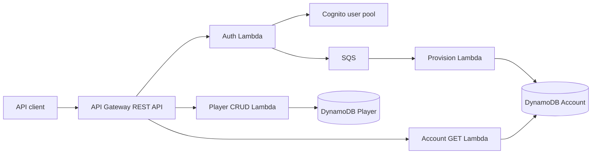

# Janus API

**Serverless C#/.NET 10 portfolio reference** using AWS Lambda, API Gateway, Cognito, SQS and DynamoDB.

> **Historical prototype being modernized.** The implementation, tests and infrastructure template are not yet verified together in an AWS sandbox. Do not use it as a hosted identity service or production deployment.

## Architecture



Signup creates a Cognito user and enqueues an account provision event. SQS delivers at least once; a conditional DynamoDB put preserves a previously created account. Record endpoints accept only the Cognito subject's data, checked in the Lambda and restricted by the API Gateway authorizer.

## Auth and API surface

| Route | Methods | Access |
| --- | --- | --- |
| `/signup`, `/authenticate`, `/reset` | POST | Usage-plan API key; Cognito identity actions |
| `/account` | GET | Usage-plan API key + Cognito ID token |
| `/player` | GET, POST, PUT, DELETE | Usage-plan API key + Cognito ID token |

For authorized requests, use `Authorization: <Cognito ID token>` and `X-Api-Key: <API Gateway usage-plan key>`. The key is **not identity authentication**. API Gateway is configured with a Cognito default authorizer; the three auth flows explicitly opt out while retaining their API-key requirement.

The generic `/data` endpoint is **not registered**. Account HTTP mutation is disabled. An optional record `id` may be supplied only if it matches the authenticated `sub`; the effective record key always comes from verified authorizer claims.

## Local build and infrastructure validation

Install the [.NET 10 SDK](https://dotnet.microsoft.com/download/dotnet/10.0) and [AWS SAM CLI](https://docs.aws.amazon.com/serverless-application-model/latest/developerguide/install-sam-cli.html). No npm or Serverless Framework account is required.

```bash
./build.sh
sam validate --template-file template.yaml --region ca-central-1 --lint
```

`build.sh` runs restore, build, tests, and produces three Lambda publish directories under `dist/`. The SAM template points at those artifacts; validation and deployment are separate operations.

**Local validation:** .NET SDK 10.0.100 successfully restored and built the solution, ran six C# unit tests, and published all three Lambda artifact directories on a temporary Linux environment. Separately, `cfn-lint` and six infrastructure contract tests passed. **AWS SAM CLI 1.168.0 validates the template locally (including `--lint` with a documented W3005 exception for generated usage-plan dependencies). SAM packaging/deployment, cloud-side Cognito/SQS integration, and hosted CI have not been validated.** See [issue #7](https://github.com/ryjen/janus-api/issues/7).

## Sandbox deployment (manual, after verification)

The template is stack-scoped. To test in disposable AWS infrastructure, review the plan, pricing and identity configuration, then package/deploy via SAM using dedicated sandbox credentials. There is **no automatic deploy workflow**, no published endpoint, and no migration of old Janus data or Cognito users. A fresh stack uses new tables and identities, with point-in-time recovery enabled for its DynamoDB tables.

For IAM, SAM creates separate execution roles for authentication, HTTP data access and account provisioning. SQS accounts have a retry policy and dead-letter queue. API Gateway usage plans throttle traffic; they are not a comprehensive anti-abuse control.

## Project material

- [Architecture and trust boundaries](docs/architecture.md)
- [Security limitations and reporting](SECURITY.md)
- [Publication and history gate](docs/publication-gate.md)
- [Changelog](CHANGELOG.md)

**Public status:** still private pending clean-history and credential-revocation review. This reference has not been licensed for third-party reuse.
