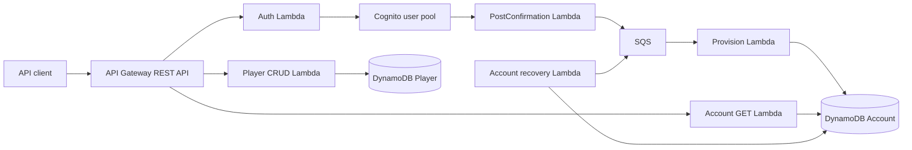

# Janus API

**Serverless C#/.NET 10 portfolio reference** using AWS Lambda, API Gateway, Cognito, SQS and DynamoDB.

> **Historical prototype being modernized.** The implementation, tests and infrastructure template are not yet verified together in an AWS sandbox. Do not use it as a hosted identity service or production deployment.

## Architecture



Signup uses Cognito self-enrollment, followed by email-code confirmation at `POST /confirm`. **Only the trusted Cognito PostConfirmation trigger** enqueues an account provision event. SQS delivers at least once; a conditional DynamoDB put preserves a previously created account. If confirmation succeeded but SQS provisioning was interrupted, an authenticated user with a verified email can call `POST /account/reconcile` to request idempotent recovery of their own missing account (202 queued, 200 already present, or 401/403/503). Record endpoints accept only the Cognito subject's data, checked in the Lambda and restricted by the API Gateway authorizer.

## Auth and API surface

| Route | Methods | Access |
| --- | --- | --- |
| `/signup`, `/confirm`, `/authenticate` | POST | Usage-plan API key; Cognito enrollment/authentication |
| `/password/forgot` | POST | Usage-plan API key; request a reset code using `email` (non-enumerating response) |
| `/password/confirm` | POST | Usage-plan API key; redeem `email`, `code`, `password` to set a new password; then authenticate again |
| `/reset` | POST | Legacy `NEW_PASSWORD_REQUIRED` administrator-created-user challenge; **not** a forgot-password flow |
| `/account` | GET | Usage-plan API key + Cognito ID token |
| `/account/reconcile` | POST | Usage-plan API key + Cognito ID token with verified email |
| `/player` | GET, POST, PUT, DELETE | Usage-plan API key + Cognito ID token |

For authorized requests, use `Authorization: <Cognito ID token>` and `X-Api-Key: <API Gateway usage-plan key>`. The key is **not identity authentication**. The Cognito app client explicitly enables `PreventUserExistenceErrors` for authentication and recovery. Signup also maps Cognito's `UsernameExistsException` to the same generic successful response as an eligible signup. These measures **reduce**, but do not eliminate, account-enumeration risk (for example, timing and delivery behavior). Password recovery responds generically to unknown accounts and requires Cognito's confirmation code to change a password. Neither policy replaces abuse/rate-limit testing in AWS. API Gateway is configured with a Cognito default authorizer; the six unauthenticated identity routes explicitly opt out while retaining their API-key requirement.

The generic `/data` endpoint is **not registered**. Account HTTP mutation is disabled. An optional record `id` may be supplied only if it matches the authenticated `sub`; the effective record key always comes from verified authorizer claims.

## Local build and infrastructure validation

Install the [.NET 10 SDK](https://dotnet.microsoft.com/download/dotnet/10.0), [AWS SAM CLI](https://docs.aws.amazon.com/serverless-application-model/latest/developerguide/install-sam-cli.html), and a native `zip` utility on Linux. The SAM build uses the AWS Lambda .NET packaging tool, which SAM installs when needed. No npm or Serverless Framework account is required.

```bash
./build.sh
sam validate --template-file template.yaml --region ca-central-1 --lint
```

`build.sh` restores and tests the solution, then runs `sam build` on the three source projects (`auth/`, `account/`, and `player/`) to create deployable Lambda archives and a transformed template under `.aws-sam/build/`. This avoids stale `dist/` outputs. The script validates the source SAM template and **does not deploy**. Windows developers can use `build.cmd`.

**Build and test verification:** .NET SDK 10.0.100 locally restored and built the lifecycle refactor with zero warnings and ran **68/68 C# tests** and **11/11 infrastructure contract tests**. Hosted GitHub Actions [run 38348040446](https://github.com/ryjen/janus-api/actions/runs/38348040446) subsequently passed on source/CI revision `b8aa2f1d2bd6f0b45bf2f3d16120dbf76d280867`, including source-based SAM packaging, C# tests, infrastructure tests and lint. The review/documentation-only revision following this run does not change Lambda or infrastructure code. **No AWS deployment, live Cognito/SQS integration or credential-history clearance is claimed.** See [#7](https://github.com/ryjen/janus-api/issues/7) and [#9](https://github.com/ryjen/janus-api/issues/9).

## Sandbox deployment (manual, after verification)

The template is stack-scoped. To test in disposable AWS infrastructure, review the plan, pricing and identity configuration, then package/deploy via SAM using dedicated sandbox credentials. There is **no automatic deploy workflow**, no published endpoint, and no migration of old Janus data or Cognito users. A fresh stack uses new tables and identities, with point-in-time recovery enabled for its DynamoDB tables.

For IAM, SAM creates separate execution roles for authentication, HTTP data access and account provisioning. SQS accounts have a retry policy and dead-letter queue. API Gateway usage plans throttle traffic; they are not a comprehensive anti-abuse control.

## Project material

- [Architecture and trust boundaries](docs/architecture.md)
- [Record application boundaries and follow-up design](docs/record-boundary.md)
- [Security limitations and reporting](SECURITY.md)
- [Publication and history gate](docs/publication-gate.md)
- [Changelog](CHANGELOG.md)

**Enrollment design:** self-signup, email-code confirmation, and a Cognito PostConfirmation trigger are now implemented. The end-to-end behaviour is **not independently tested in AWS**; see [security issue #9](https://github.com/ryjen/janus-api/issues/9).

**Public exposure notice:** The repository is currently **public**, but visibility was changed before the historical credential, licensing, clean-history and independent-review gates were completed. Git history may contain material that should not have been published. Treat historical credentials as potentially compromised and rotate/revoke them at their providers; removing content from the latest branch or reverting visibility does not undo prior access. See [publication remediation #7](https://github.com/ryjen/janus-api/issues/7). No open-source license has been approved for third-party reuse. This is **not** a hosted or production-ready service.
