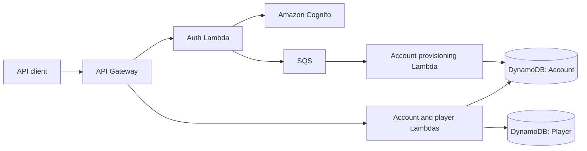

# Janus API

**Serverless .NET backend reference implementation** — AWS Lambda, API Gateway, Amazon Cognito, DynamoDB, and SQS.

> **Status: historical prototype under modernization.** This repository documents serverless architecture and its security trade-offs; it is **not** a vetted production identity service or a hosted API. No deployed AWS environment has been verified.

## Architecture



Janus explores separating identity lifecycle from account persistence. Cognito manages identity; signup queues account provisioning through SQS. DynamoDB stores application records. Account and player read/write routes are scoped to the authenticated Cognito subject. See [architecture and design decisions](docs/architecture.md).

## Supported API surface

| Route | Method | Access | Notes |
| --- | --- | --- | --- |
| `/signup` | POST | API key | Starts Cognito signup and queues account provisioning; takes `email` and `password`. |
| `/authenticate` | POST | API key | Cognito authentication, returns token or new-password challenge. |
| `/reset` | POST | API key | Completes new-password challenge with its session. |
| `/account` | GET | API key + Cognito bearer token | Reads only the authenticated subject's account. |
| `/player` | GET/POST/PUT/DELETE | API key + Cognito bearer token | Operates only on the authenticated subject's player record. |

The former generic `/data` CRUD endpoint is **not deployed**: accepting a caller-selected table and record ID was an unsafe boundary. Account mutation is also disabled at the HTTP layer. API keys are not user authentication; the Cognito authorizer is applied separately to identity-scoped record routes. Do not infer production readiness from these safeguards alone.

A client may omit the `id` query/body field on account and player routes; when provided it must match the token subject. The server always obtains the actual record ID from the authorizer claims, never from the supplied field.

## Build and test

Prerequisites: [.NET 10 SDK](https://dotnet.microsoft.com/download/dotnet/10.0), `zip`, Node.js/npm, and the Amazon Lambda .NET CLI tooling. AWS credentials are required only for an explicitly authorized deployment.

```bash
npm ci
dotnet restore
dotnet build janus.sln --configuration Release
dotnet test tests/janus.tests.csproj --configuration Release
./build.sh
```

For a local-only configuration check (no deployment):

```bash
API_KEY=local-not-for-deployment npx serverless print --stage sandbox
```

**Do not deploy this template to an existing Janus environment.** Resource names and tables now include the Serverless stage, and .NET 10 replaces .NET 6; existing DynamoDB records, Cognito users and deployment state are not automatically migrated.

A first sandbox deployment requires separately scoped AWS credentials and a generated API key (for example, `openssl rand -hex 32` in a gitignored `.env` file). Review IAM, billing, Cognito signup-abuse controls, DynamoDB throughput and migration plans first. Never commit or share credentials.

## Design and limitations

- [Architecture and trust boundaries](docs/architecture.md)
- [Publication gate](docs/publication-gate.md)
- [Security reporting](SECURITY.md)
- [Changelog](CHANGELOG.md)

The implementation retains several prototype constraints: provider-wide IAM permissions rather than per-Lambda roles, limited request schema validation, unverified AWS deployment/integration behaviour, no rate limiting or abuse-control design, and no migration tooling. The tests are not an end-to-end security assurance. The project has not yet been assigned an open-source license.

## Background

The name refers to Janus, the Roman god of gates, transitions and passages. The project is intended as an architectural learning exercise, not an authentication product.
