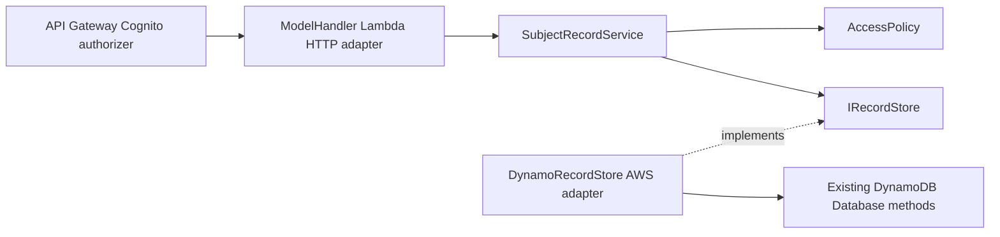

# Player and account records: clean architecture boundary

Playstate remains a small serverless prototype. These seams are deliberate; a general
DI container, mediator, generic repository or domain-event framework would add
complexity without addressing current risks.

## Ports and adapters

- **HTTP adapter** parses API Gateway envelopes and translates application outcomes
  into 401/403/404/405/200 responses, invalid JSON to 400, and infrastructure
  errors to 503, including infrastructure `ArgumentException` failures. The
  400 classification applies **only during JSON body parsing**. The adapter does
  not construct a table name from request data.
- **Application service** validates the Cognito subject and optional caller ID;
  no store method executes for failed authorization. Account's read-only behavior
  is enforced here as well.
- **Repository port** is bound to one record collection and uses no AWS SDK
  types. This seam makes authorization and mapping tests deterministic without
  touching Cognito or DynamoDB.
- **Infrastructure adapter** translates operations into existing DynamoDB
  requests and uses trusted `ACCOUNT_TABLE` or `PLAYER_TABLE` configuration.
  It preserves the existing response JSON and DynamoDB item shape.

### Scope and limitations

The public routes, Lambda handler signatures, table schemas and permission
boundaries are unchanged. One intentional correction: malformed record bodies
return 400 while AWS persistence failures now return 503, not the misleading 400.
An explicit null, blank, non-string or contradictory `id` fails
authorization instead of being coerced or treated as absent.
The current POST/PUT paths still share the historical update/upsert behavior;
this is not a claim of REST create-vs-update semantics.

These local unit tests prove service decisions; they do not prove API Gateway
claim verification, DynamoDB conditional behavior, or AWS infrastructure.

## Next slices (not implemented by this PR)

1. Split account HTTP query, confirmed-event publisher and SQS provisioner into
   separate handler classes; use constructor injection for `IAmazonSQS` and
   `IAmazonCognitoIdentityProvider`. Maintain parameterless Lambda constructors.
2. Replace loosely typed API maps and legacy `Request` types with validated,
   versioned DTOs for player fields, payload-size bounds and explicit PATCH/PUT
   and POST behavior. Use tests to freeze compatibility before changing semantics.
3. Give account provisioning its own typed port, conditional-write/retry tests
   and provider-independent idempotency; validate SQS/IAM integration in AWS.
4. Introduce explicit application error categories, safe structured telemetry
   (never log passwords, tokens, email bodies or SQS message contents) and
   correlation IDs. Do not expose underlying exception strings.
5. Evaluate dependency updates and avoid mixing AWS SDK v4 migration with
   this isolation refactor. Keep deployment/publication gates #7/#9 open.
